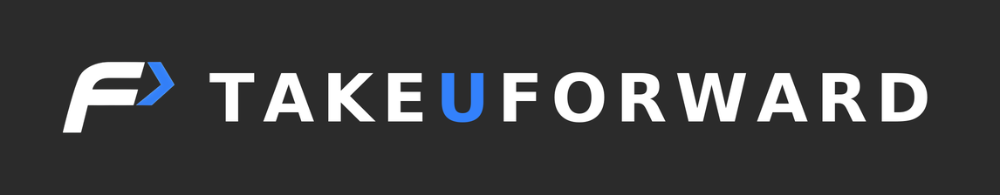
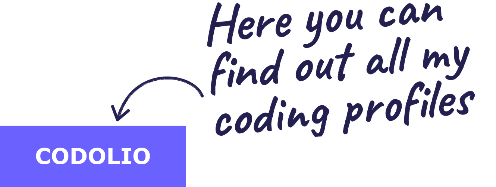

  

  
  

<h1 align="center">
  <picture>
    <!-- Dark mode -->
    <source
      media="(prefers-color-scheme: dark)"
      srcset="https://readme-typing-svg.herokuapp.com/?font=Righteous&size=30&center=true&vCenter=true&lines=Hey+There!+👋;+I'm+Arin+Anil+Jadhav!;&color=EAEAEA"
    />
    <!-- Light mode -->
    <source
      media="(prefers-color-scheme: light)"
      srcset="https://readme-typing-svg.herokuapp.com/?font=Righteous&size=30&center=true&vCenter=true&lines=Hey+There!+👋;+I'm+Arin+Anil+Jadhav!;&color=20BEFF"
    />
    
  </picture>
</h1>

  <h2>M.Tech @ IIT Patna '27 | UGC-NET Qualified | Ex-NIT Rourkela Intern | AI Research Enthusiast | Data Scientist | Python • AI/ML • Data Science</h2>

<h3><b>🎯 Open To:</b> Internship & Roles in AI/ML Engineering · Software Engineering</h3>

  <a href="https://drive.google.com/drive/folders/1hnkcJUHB-fCl9Pk1T_FgP44dEhCrCnUj?usp=sharing" target="blank">
    <picture>
      <source media="(prefers-color-scheme: dark)" srcset="./assets/social-icons/Resume-dark.svg" />
      <source media="(prefers-color-scheme: light)" srcset="./assets/social-icons/Resume-light.svg" />
      
    </picture>
  </a>

 

### Connect with me:

&nbsp;&nbsp;

&nbsp;&nbsp;

&nbsp;&nbsp;

&nbsp;&nbsp;

&nbsp;&nbsp;

### Code with me:

  
  
  
  
  
  <a href="https://codolio.com/profile/arinj10" target="blank">
    <picture>
      <source media="(prefers-color-scheme: dark)" srcset="./assets/social-icons/codolio-dark.png" />
      <source media="(prefers-color-scheme: light)" srcset="./assets/social-icons/codolio-light.png" />
      
    </picture>
  </a>

### Beyond the Code:

&nbsp;&nbsp;

&nbsp;&nbsp;

### About me:

  
I turn messy data into meaningful logic 🧠

  

    I'm currently pursuing my <strong>M.Tech in Artificial Intelligence</strong> at <strong>IIT Patna</strong>, and I’m passionate about transforming data into intelligent, human-centered solutions.
  

  

    Before IIT, I earned my <strong>B.Tech in AI &amp; Data Science</strong> from <strong>LSP Government College of Engineering, Ratnagiri</strong>, where I explored the exciting edge of real-world AI. Building everything from a virtual assistant (JARVIS) to a smart healthcare automation system that bagged the <strong>Best Project Award</strong> 🏆 at <strong>NIT Rourkela</strong>.
  

  

    I love building solutions that combine code and compassion, systems that don't just compute but contribute. My toolkit includes <strong>C</strong>, <strong>C++</strong>, <strong>Python</strong>, <strong>SQL</strong>, <strong>ASP.NET MVC</strong>, and modern web technologies, and I’m constantly pushing boundaries through hands-on projects and <strong>full-stack learning</strong> at <strong>NxtWave’s CCBP 4.0 Academy</strong>.
  

 

## Languages & Tools:

### 𝖫𝖺𝗇𝗀𝗎𝖺𝗀𝖾𝗌 :

  
  
  
  
  
  

### 𝖣𝖾𝗏𝖾𝗅𝗈𝗉𝗆𝖾𝗇𝗍 :

  
  
  
  
  

### 𝖴𝗍𝗂𝗅𝗂𝗍𝗂𝖾𝗌 :

  
  
  
  
  
  
  
  
  
  
  

 

## 🚀 Featured Projects

<b>🎬 Movie Recommender System using TMDB</b>

 

Content-based movie recommendation system built on the TMDB dataset. It uses cosine similarity over features such as genres, keywords, and cast/crew to recommend movies with similar characteristics.

| | |
|---|---|
| **Stack** | Python, Jupyter Notebook, Pandas, NumPy, Scikit-learn |
| **Approach** | Content-based filtering using cosine similarity on combined genre, keyword, and cast/crew features |
| **Core Features** | Movie similarity analysis and personalized recommendations based on movie metadata |
| **Repository** | [Movie-Recommender-System-using-TMDB](https://github.com/arinjadhav/Movie-Recommender-System-using-TMDB) |
 

<b>🏥 Smart Healthcare Automation System (SHAS) 🏆</b>

 

A full-stack Healthcare automation web application designed to streamline patient registration, appointment scheduling, pharmacy and blood bank inventory, and billing, featuring an AI-powered healthcare chatbot (Dr. Iris) and secure online payments. Awarded **Best Project** at NIT Rourkela during InterSEP 2025.

| | |
|---|---|
| **Stack** | C#, ASP.NET Core MVC, Microsoft SQL Server, HTML5, CSS3, JavaScript, Bootstrap, Google Gemini API, Razorpay |
| **Core Features** | Role-based dashboards for Admins, Doctors, and Patients; appointment management; pharmacy expiry tracking; blood bank inventory; automated notifications |
| **AI Integration** | Dr. Iris, a Gemini-powered chatbot for patient assistance, hospital navigation, and basic health-related queries |
| **Security** | JWT-based authentication, SHA-256 password hashing, role-based access control |
| **Payments & Communication** | Razorpay payment gateway, SMTP email notifications, SMS gateway integration |
| **Recognition** | 🏆 Best Project Award - InterSEP 2025, NIT Rourkela |
| **Repository** | [Smart-Healthcare-Automation-System](https://github.com/arinjadhav/Smart-Healthcare-Automation-System) |

Built end-to-end during the InterSEP 2025 internship at NIT Rourkela, integrating healthcare workflows, AI-powered patient assistance, secure authentication, and payment processing into a unified web application.

 

<b>🤖 JARVIS Virtual Assistant</b>

 

AI-powered desktop assistant built with Python that uses voice commands, speech recognition, and natural language processing to retrieve information, automate tasks, and enable real-time user interaction.

| | |
|---|---|
| **Stack** | Python, SpeechRecognition, PyAudio, OpenAI API |
| **Core Features** | Voice-based commands, speech recognition, information retrieval, and desktop task automation |
| **AI Integration** | OpenAI API for AI-powered interactions |
| **Repository** | 🚧 Work in Progress |
 

<b>🕹️ Flappy Bird Game</b>

 

A Python-based recreation of the classic Flappy Bird arcade game using Pygame, featuring real-time player controls, obstacle avoidance, and collision detection for an engaging gameplay experience.

| | |
|---|---|
| **Stack** | Python, Pygame |
| **Core Mechanics** | Bird movement, gravity-based falling, pipe obstacle navigation, and collision detection |
| **Gameplay** | Keyboard-controlled flight with increasing emphasis on timing and precision |
| **Controls** | Spacebar to flap, ESC to restart, and window close to exit |
| **Repository** | [Flappy-Bird](https://github.com/arinjadhav/Flappy-Bird-Game) |

 

## 🏅 Achievements

| Recognition | Highlights |
|---|---|
| **Best Project Award**| **Smart Healthcare Automation System (SHAS)** selected as the BEST project at **InterSEP 2025**, **NIT Rourkela** |
| **UGC-NET Qualified** | **Computer Science & Applications**, cleared in the **first attempt** (June 2026), establishing eligibility for **Ph.D. admission** |

 

## GitHub Contribution Activity:

  <picture>
    <source media="(prefers-color-scheme: dark)" srcset="https://raw.githubusercontent.com/arinjadhav/arinjadhav/output/github-snake-dark.svg" />
    <source media="(prefers-color-scheme: light)" srcset="https://raw.githubusercontent.com/arinjadhav/arinjadhav/output/github-snake.svg" />
    
  </picture>

